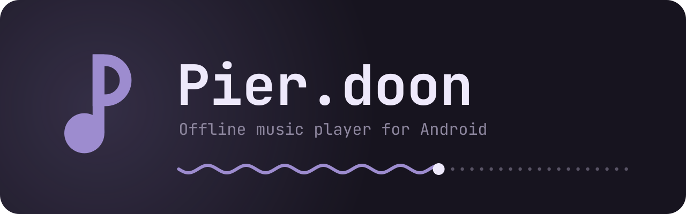

<p align="center"></p>

A small offline music player for Android and Windows. Jetpack Compose / Compose Multiplatform + Material 3 Expressive. The Windows app is described in [desktop/README.md](desktop/README.md); the rest of this page is mostly about Android.

> **Vibe-coded.** Most of this was written by an AI assistant over a chat session and tested on a single phone. Expect bugs and rough edges. Use at your own risk.

## What it does

- Plays music from your device (tracks, albums, artists), playlists, favorites
- Library search, sorting, and selecting many tracks at once to queue, add to a playlist or delete
- Sleep timer, by minutes or at the end of the track
- Media3 playback with notification / lock screen controls, hardware audio offload
- Synced lyrics from [LRCLIB](https://lrclib.net), with an immersive lyrics mode and a per-track sync offset
- Downloads tracks by link from YouTube, SoundCloud, Bandcamp and the other sites [yt-dlp](https://github.com/yt-dlp/yt-dlp) supports, with title, artist and cover; whole playlists and albums too, or search YouTube / SoundCloud by name (Android 10+)
- Edits tags and covers, in the app or in the file; deletes tracks from the device
- Expanding player, frosted glass, wallpaper / album art / custom color themes
- A Nothing-style look (monochrome, red accent, dotted progress) and a choice of fonts, monospace included
- Remote for [Pier.doon for Windows](desktop/) over Wi-Fi: the computer's playback in the app's own player, its library, and downloads sent to it
- Updates itself from GitHub releases
- Tries to go easy on the battery

## Install

Everything is on the [latest release](../../releases/latest):

- **Android**: `Pierdoon-<version>.apk`. Android 7.0+, 64-bit (arm64) phones since 1.3; older 32-bit phones can stay on 1.2.1.
- **Windows**: `Pier.doon-<version>.msi`. Windows 10/11 x64, no admin rights needed. If you have 1.0.7 or older, install 2.0 from the MSI by hand rather than with the in-app update ([why](desktop/README.md#install)).

Both apps then update themselves from this page.

## Downloading tracks

Library → download button, or share a link to Pier.doon from any app. Paste a link, or type a name to search YouTube or SoundCloud. A playlist or album link downloads every track and makes a playlist of them in the app. Tracks are saved to `Music/Pier.doon` as M4A or Opus, exactly as the site serves them (nothing is re-encoded). The downloader updates itself once a day, so a site changing usually doesn't need a new app release.

Only download what you have the rights to.

## Build

One Gradle build for both apps:

| folder | what |
| --- | --- |
| `app/` | the Android app |
| `desktop/` | [Pier.doon for Windows](desktop/README.md) (Compose Multiplatform) |
| `core/` | code both use: the track model, library lists and search, lyrics parsing, track naming, queue restore, version compare. Plain Kotlin/JVM, nothing platform-specific |
| `ui/` | Compose code both draw with: expressive shapes and buttons, the colour scheme generator, transitions, the colour picker, the expanding player, the icons. Kotlin Multiplatform (Android + JVM) |

```
./gradlew :app:assembleRelease            # APK
./gradlew :desktop:packageReleaseMsi      # Windows installer
./gradlew :core:test :desktop:test :app:lintDebug
```

Release builds of the APK are signed only if a `keystore.properties` file exists in the project root or in `Pierdoon-signing/` (`storeFile`, `storePassword`, `keyAlias`, `keyPassword`); otherwise they're left unsigned.

## Releasing

One release for both apps: tag `v<version>`, the APK and the MSI attached, marked as the **latest** release.

```
gh release create v2.0 Pierdoon-2.0.apk Pier.doon-2.0.0.msi --title "Pier.doon 2.0" --notes-file notes.md --latest
```

- Each app's updater takes the newest release that has its own file (`.apk` or `.msi`), so a release for just one of the apps works too. Android versions up to 1.6 only look at the release marked latest, so an Android release must be the latest.
- The MSI needs a three-part version (`2.0.0`); the updater treats `2.0` and `2.0.0` as the same.
- Windows versions up to 1.0.6 look for updates in the archived `kural3/Pierdoon4Desktop` repository and stop at 1.0.7 there; older tags (`android-…`, `desktop-…`) are still understood.

## License

[GNU GPL v3](LICENSE). Downloads use [youtubedl-android](https://github.com/yausername/youtubedl-android) (GPL-3.0), which runs [yt-dlp](https://github.com/yt-dlp/yt-dlp) (Unlicense). Tags are written with [jaudiotagger](https://bitbucket.org/ijabz/jaudiotagger) (LGPL). Bundled fonts: [JetBrains Mono](https://github.com/JetBrains/JetBrainsMono) and [IBM Plex Mono](https://github.com/IBM/plex), both under the SIL Open Font License (texts in `app/src/main/assets/licenses`).
