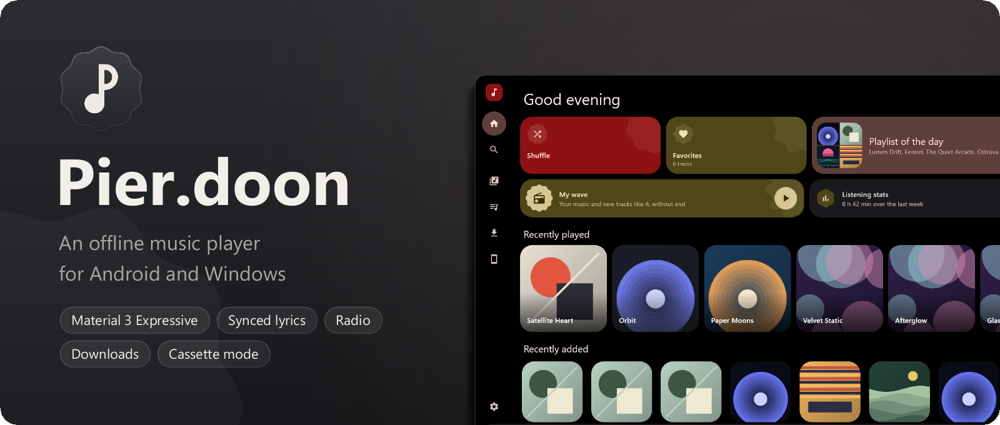
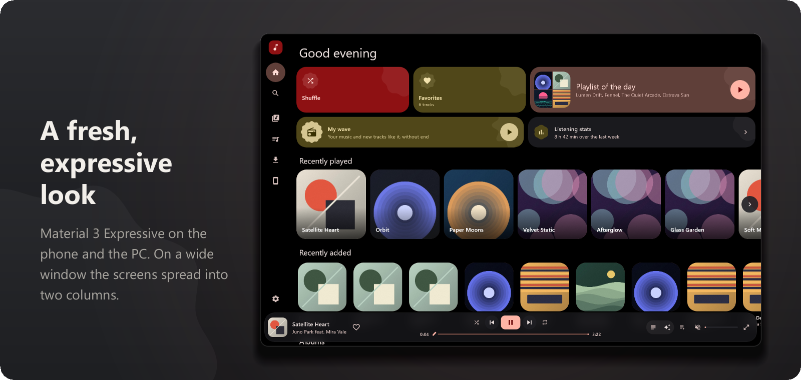
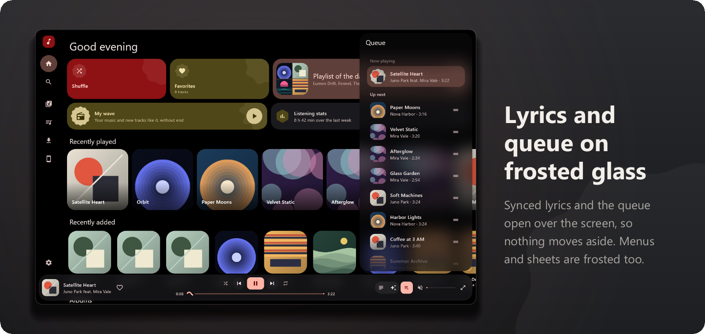
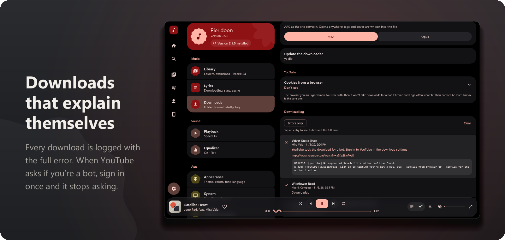

<p align="center"></p>

<p align="center">
  <a href="../../releases/latest"></a>
  
  
  <a href="LICENSE"></a>
</p>

A small offline music player for Android and Windows, with the same Material 3 Expressive look on both. Jetpack Compose on the phone, Compose Multiplatform for Desktop on the PC.

> **Vibe-coded.** Most of this was written by an AI assistant over a chat session and tested on one phone and one PC. Expect bugs and rough edges. Use at your own risk.

## Install

Take the newest file for your platform from [Releases](../../releases); after that the app updates itself from there.

- **Android**: `Pierdoon-<version>.apk`. Android 7.0+, 64-bit (arm64).
- **Windows**: `Pier.doon-<version>.msi`. Windows 10/11 x64. Installs for the current user only (no admin rights), with a Start menu entry and a desktop shortcut.

What changed in each version is in its release notes.

## A look around

<p align="center"></p>
<p align="center"></p>
<p align="center"></p>

## What it does

**On both**
- Plays your music: tracks, albums, artists, playlists, favorites, search, sorting, selecting many tracks at once to queue, add to a playlist or delete. A track tagged "A, B" or "A feat. B" counts for each artist
- A playlist of the day on the home screen: favourites, more of the artists you play most and some you haven't heard yet, new every day
- Listening stats for the week, month, year or all time: time listened, top artists and tracks, a bar per day or month
- Synced lyrics from [LRCLIB](https://lrclib.net), with a per-track sync offset. When none are found, or the wrong ones, search LRCLIB by hand and pick
- Playback speed from 0.8× to 1.25×, pitch going along (slowed, nightcore)
- Radio (beta): an endless stream of your own music mixed with new tracks like it, downloaded ahead as it plays. "Not this" skips a track and remembers it; how much is new is up to you
- Downloads by link or by search from YouTube, SoundCloud, Bandcamp and the other sites [yt-dlp](https://github.com/yt-dlp/yt-dlp) supports, with title, artist and cover; whole playlists and albums too
- A download log in Settings → Downloads: what came, what didn't and why, with yt-dlp's full error a tap away
- YouTube's "confirm you're not a bot": sign in to YouTube once (in the app on the phone, through your browser's cookies on the PC) and downloads go as your account
- Edits tags and covers, in the app or in the file
- Crossfade of up to 12 seconds between tracks, with albums left gapless unless asked otherwise
- Cassette mode (in Settings → Beta): tape hiss and wobble, a cassette with turning reels in place of the cover, the queue split into sides A and B. The deck's keys click on play and pause (from anywhere: the app, the notification, headphones, media keys), next and previous spin the tape to the track (paused too), the cassette is turned over after side A or when next and previous cross the middle, and rewound after side B when the queue repeats, for longer the longer the side
- Playlists in and out as `.m3u` / `.m3u8`, finding tracks by path, then by name and tags
- English and Russian interface: the system's language by default, or chosen in Settings → Appearance
- Material 3 Expressive throughout: expressive shapes, a player whose toggles sit together in one capsule, frosted glass in menus and sheets
- Expanding player, album art / wallpaper or Windows accent / custom color themes, a Nothing-style look (monochrome, red accent, dotted progress) and a choice of fonts, your own TTF or OTF file among them
- The phone works as a remote for the computer over Wi-Fi: the computer's playback in the phone's own player, its queue, lyrics and library, and downloads sent to it
- Copies tracks between the phone and the computer over Wi-Fi, byte for byte: "Send to computer" on the phone's tracks and playlists, "Save to phone" on the computer's. Tracks that look like ones already there (same title, artist and length) are pointed out first

**Android**
- Media3 playback with notification and lock screen controls
- Home screen widget with the cover and playback buttons
- Android Auto: playlists, albums, artists, tracks, search and voice requests. Android Auto lists apps from outside Google Play only with "Unknown sources" on in its developer settings
- Sleep timer, by minutes or at the end of the track
- Immersive lyrics mode, landscape player
- Swipe the mini player or the cover sideways to change track
- Share a link to Pier.doon from any app to download it (Android 10+)
- Tries to go easy on the battery

**Windows**
- Plays music from folders on your computer (Music by default; add more, or leave subfolders out, in Settings → Library). Deleting sends files to the Recycle Bin
- Any format FFmpeg reads (MP3, M4A/AAC, FLAC, Opus, Ogg, WAV, WMA, APE, WavPack…), gapless between tracks, output device choice, skip silence
- Media keys and the Windows media overlay, tray icon (closing the window keeps the music playing), one instance at a time
- Discord status ("Listening to Pier.doon"), switched on in Settings → System
- Delicious mode: the lyrics line by line, lit as they are sung, over soft visuals in the cover's colours that move with the music, in four styles, with a dock for the playback controls
- Desktop layout: resizable navigation on the left, a player bar along the bottom that unfolds into a two-column full player, lyrics or queue in a frosted panel over the screen, right-click menus. Settings, downloads, the tag editor and the phone page spread into two columns on a wide window, and rows of covers scroll by dragging or by the arrows at their ends. Drop a link on the window to download it

## Downloading tracks

Paste a link, or type a name to search YouTube or SoundCloud. A playlist or album link downloads every track and makes a playlist of them in the app. Tracks go to `Music/Pier.doon` (on Windows, any folder you choose) as M4A or Opus, exactly as the site serves them, nothing re-encoded. The downloader updates itself, so a site changing usually doesn't need a new app release. On Windows, yt-dlp.exe is fetched on first use and checked against its published SHA-256, and so is [deno](https://deno.com), which yt-dlp needs for YouTube's player (downloads go on without it until it's there).

When a track doesn't come, Settings → Downloads → Download log says why. If YouTube took the download for a bot, sign in to YouTube on the same page: on the phone it opens Google's sign-in, on Windows pick the browser you're signed in with (Firefox works best; Chrome and Edge often won't let their cookies be read). The cookies stay on your device and go only to yt-dlp.

Only download what you have the rights to.

## Keyboard (Windows)

| Key | Action |
| --- | --- |
| ← / → | Seek 5 s |
| Ctrl+← / Ctrl+→ | Previous / next track |
| Ctrl+↑ / Ctrl+↓ | Volume |
| Ctrl+F | Search |
| Esc, Alt+←, mouse back button | Back |

## Where things live on Windows

- Settings, playlists, favorites, history, the saved queue, picked covers: `%APPDATA%\Pier.doon`
- Error log (attach it to a bug report): `%APPDATA%\Pier.doon\logs\errors.log`
- Library index, lyrics cache: `%LOCALAPPDATA%\Pier.doon Data\cache`
- Download log: `%APPDATA%\Pier.doon\download-log.json`
- yt-dlp and deno: `%LOCALAPPDATA%\Pier.doon Data\tools`
- The app itself: `%LOCALAPPDATA%\Pier.doon`. Every upgrade and uninstall wipes this folder, so the app keeps nothing else there.

## Build

One Gradle build for both apps. Any JDK starts Gradle; the JDK 25 it builds with is downloaded if missing.

| folder | what |
| --- | --- |
| `app/` | the Android app |
| `desktop/` | the Windows app |
| `core/` | code both use: the track model, library lists and search, playlists and favourites, tag edits, lyrics (LRCLIB, parsing, sync offsets), tag search and Opus tags, listening stats and the playlist of the day, track naming, the queue, the settings both apps have (and the keys they're saved under), update state, version compare. Plain Kotlin/JVM, nothing platform-specific |
| `ui/` | Compose code both draw with: every string (en, ru), expressive shapes and buttons, the colour scheme generator, transitions, the colour picker, the expanding player, the queue and lyrics panels, track rows, the welcome screen and the update dialog, the icons. Kotlin Multiplatform (Android + JVM); what each app does its own way sits in `androidMain` / `jvmMain` |
| `baselineprofile/` | walks the Android app on a phone to record the code it runs first; the profile goes into `app/src/main/generated` and ships in the APK |
| `docs/` | [the phone ↔ computer protocol](docs/remote-api.md), and the README's pictures with the program that draws them (`Banners.java`) |

```
./gradlew :app:assembleRelease          # APK
./gradlew :desktop:run                  # start the Windows app
./gradlew :desktop:packageReleaseMsi    # installer, in desktop/build/compose/binaries/main-release/msi
./gradlew :core:test :desktop:test :app:testDebugUnitTest :app:lintDebug
./gradlew :app:connectedDebugAndroidTest -PsideBySideTests   # on a plugged-in phone, beside the installed app
./gradlew :app:generateBaselineProfile  # re-record the startup profile on a plugged-in phone (its own copy of the app)
```

Release builds of the APK are signed only if a `keystore.properties` file exists in the project root or in `Pierdoon-signing/` (`storeFile`, `storePassword`, `keyAlias`, `keyPassword`); otherwise they're left unsigned.

The icon (every PNG, the Windows .ico and the Android fallbacks) is drawn by `java desktop/icons/Icon.java . preview.png`; the Android adaptive icon is the same mark in `app/src/main/res/drawable/ic_launcher_*.xml`.

`./gradlew :desktop:shots -PshotsScript=<file>` renders the Windows app off screen from a script of steps (clicks, drags, waits, screenshots, frame timings) on a separate copy of the app data; see `desktop/src/test/kotlin/com/ku/pierdoon/Shots.kt`.

## Releasing

The apps can be released together or one at a time. Notes are in Russian.

| release | tag | files | latest |
| --- | --- | --- | --- |
| both apps | `v<version>` | APK and MSI | yes |
| Android only | `android-<version>` | APK | yes |
| Windows only | `desktop-<version>` | MSI | no (`--latest=false`) |

```
gh release create v<version> Pierdoon-<version>.apk Pier.doon-<version>.msi --title "Pier.doon <version>" --notes-file notes.md --latest
gh release create android-<version> Pierdoon-<version>.apk --title "Pier.doon <version> для Android" --notes-file notes.md --latest
gh release create desktop-<version> Pier.doon-<version>.msi --title "Pier.doon <version> для Windows" --notes-file notes.md --latest=false
```

- Each app's updater takes the newest release that has its own file (`.apk` or `.msi`) and ignores the rest, so a release for one app never offers anything to the other.
- The two apps' version numbers move independently; the prefixes keep their tags from clashing. Bump the version in `app/build.gradle.kts` or `desktop/build.gradle.kts` only for the app being released.
- Older Android versions only look at the release marked latest, so a release with an APK must be the latest and a Windows-only one must not.
- The MSI needs a three-part version (`x.y.0`); the updater treats `x.y` and `x.y.0` as the same.
- Never keep files in the Windows install folder: the installer wipes it on every upgrade.

## License

[GNU GPL v3](LICENSE). Downloads use [yt-dlp](https://github.com/yt-dlp/yt-dlp) (Unlicense), on Android through [youtubedl-android](https://github.com/yausername/youtubedl-android) (GPL-3.0). Tags are written with [jaudiotagger](https://bitbucket.org/ijabz/jaudiotagger) (LGPL). Windows playback uses FFmpeg through [JavaCV](https://github.com/bytedeco/javacv). Bundled fonts: [JetBrains Mono](https://github.com/JetBrains/JetBrainsMono) and [IBM Plex Mono](https://github.com/IBM/plex), both under the SIL Open Font License (texts in `app/src/main/assets/licenses`). The cassette being turned over and the deck's keys are cut from [cassette tape action.wav](https://freesound.org/people/cognito%20perceptu/sounds/98330/) by cognito perceptu (CC0), the rewind and the spin from [cassette tape action 2.wav](https://freesound.org/people/cognito%20perceptu/sounds/98329/) by the same author (CC0).
