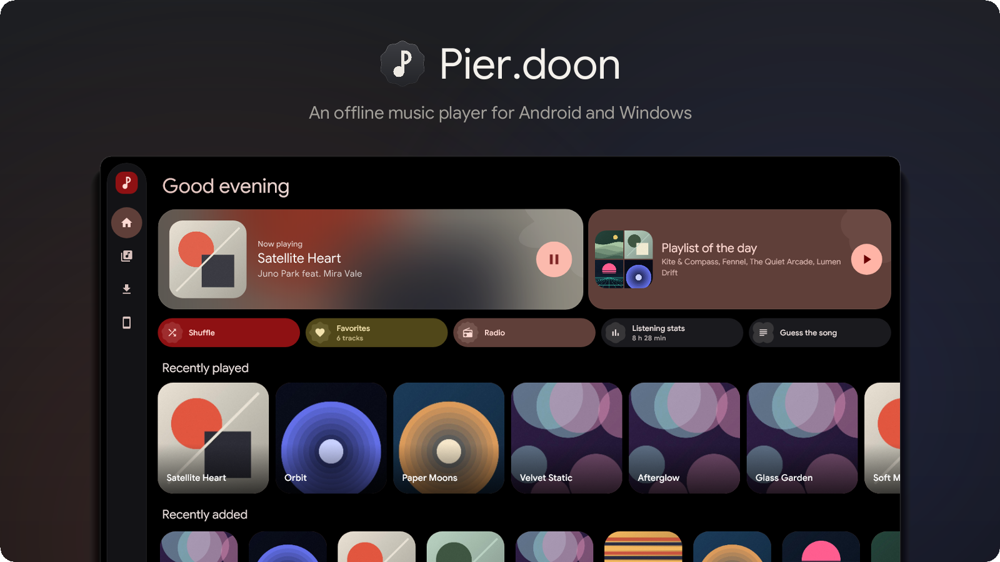
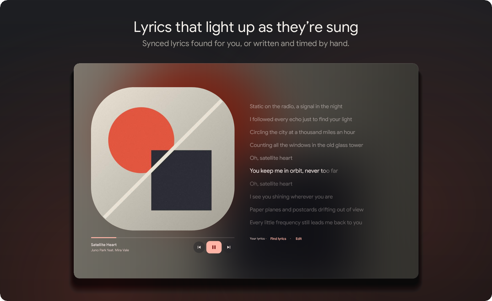
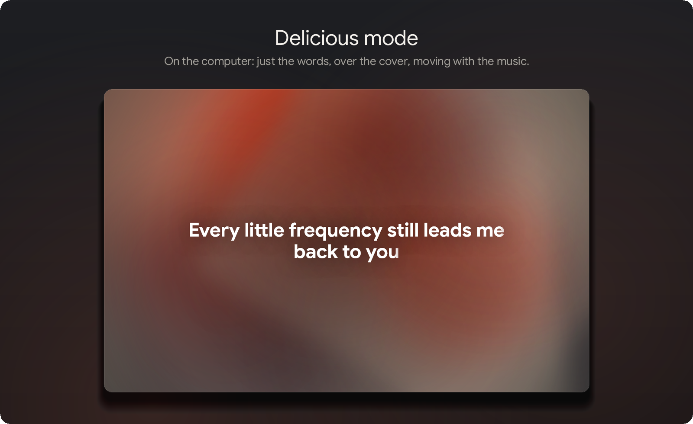

<p align="center"></p>

<p align="center">
  <a href="../../releases/latest"></a>
  
  
  <a href="LICENSE"></a>
</p>

<p align="center">
  A small music player for your own files, on the phone and the PC, with the same Material 3 Expressive look on both.
</p>

<p align="center">
  <a href="../../releases/latest"><b>Download</b></a> ·
  <a href="#what-it-does">What it does</a> ·
  <a href="#for-developers">For developers</a>
</p>

> **Vibe-coded.** Most of this was written by an AI assistant over a chat session and tested on one phone and one PC. Expect bugs and rough edges. Use at your own risk.

## Install

Take the newest file for your platform from [Releases](../../releases/latest). After that the app updates itself.

| | file | needs |
| --- | --- | --- |
| **Android** | `Pierdoon-<version>.apk` | Android 7.0+, 64-bit |
| **Windows** | `Pier.doon-<version>.msi` | Windows 10/11 x64, no admin rights |

<p align="center"></p>

## What it does

- 🎵 **Your music, nicely kept.** Tracks, albums, artists, playlists (smart ones too), favourites, search, tag and cover editing, a duplicate finder, `.m3u` import and export
- 🎤 **Lyrics** from [LRCLIB](https://lrclib.net) and [Genius](https://genius.com), lit word by word as they're sung; or write and time your own
- 📻 **Radio:** your music mixed with new tracks like it, without end
- 📅 **A playlist of the day,** listening stats and a year in review in December and January
- ⬇️ **Downloads** by link or search from YouTube, SoundCloud, Bandcamp and more through [yt-dlp](https://github.com/yt-dlp/yt-dlp), whole albums and playlists too, as they come or as MP3/FLAC
- 📱↔💻 **Phone and PC together:** the phone works as a remote for the computer, tracks are copied between them over Wi-Fi, favourites and playlists stay in sync
- 🎛️ **Sound:** crossfade, gapless albums, an equalizer, speed and pitch (slowed, nightcore)
- 📼 **Cassette mode:** tape hiss, turning reels, sides A and B
- 🎨 **Looks:** colours from the cover or any you pick, frosted glass, a Nothing-style look, your own font, English and Russian

**Only on Android:** notification and lock screen controls, a home screen widget, Android Auto, a sleep timer.
**Only on Windows:** a mini player, media keys, a tray icon, Discord status and the Delicious mode below.

<p align="center"></p>

Only download what you have the rights to.

## For developers

<details>
<summary><b>Build</b></summary>

One Gradle build for both apps. Any JDK starts Gradle; the JDK 25 it builds with is downloaded if missing.

| folder | what |
| --- | --- |
| `app/` | the Android app |
| `desktop/` | the Windows app |
| `core/` | plain Kotlin/JVM both use: the track model, library, playlists, lyrics, stats, the queue, settings, yt-dlp output, updates |
| `ui/` | Compose code both draw with, and the app state behind it (`AppModel`); Kotlin Multiplatform, with each app's own ways in `androidMain` / `jvmMain` |
| `baselineprofile/` | records the Android app's startup profile on a phone |
| `docs/` | [the phone ↔ computer protocol](docs/remote-api.md), and the programs that make the README's pictures |

```
./gradlew :app:assembleRelease          # APK
./gradlew :desktop:run                  # start the Windows app
./gradlew :desktop:packageReleaseMsi    # installer, in desktop/build/compose/binaries/main-release/msi
./gradlew :core:test :desktop:test :app:testDebugUnitTest :app:lintDebug
./gradlew :app:connectedDebugAndroidTest -PsideBySideTests   # on a plugged-in phone, beside the installed app
./gradlew :app:generateBaselineProfile  # re-record the startup profile on a plugged-in phone (its own copy of the app)
```

- Release APKs are signed only if a `keystore.properties` file (`storeFile`, `storePassword`, `keyAlias`, `keyPassword`) is in the project root or in `Pierdoon-signing/`.
- The MSI needs the JetBrains Runtime SDK (`jbr.dir` in `local.properties`), or the window loses its own title bar.
- The icon is drawn by `java desktop/icons/Icon.java . preview.png`.
- `./gradlew :desktop:shots -PshotsScript=<file>` renders the Windows app off screen from a script of steps; see `desktop/src/test/kotlin/com/ku/pierdoon/Shots.kt`. The README's pictures are made this way on a made-up library (`docs/DemoData.java`, then `docs/Banners.java`).

</details>

<details>
<summary><b>Releasing</b></summary>

The apps can be released together or one at a time. Notes are in Russian.

| release | tag | files | latest |
| --- | --- | --- | --- |
| both apps | `v<version>` | APK and MSI | yes |
| Android only | `android-<version>` | APK | yes |
| Windows only | `desktop-<version>` | MSI | no (`--latest=false`) |

```
gh release create v<version> Pierdoon-<version>.apk Pier.doon-<version>.msi --title "Pier.doon <version>" --notes-file notes.md --latest
gh release create android-<version> Pierdoon-<version>.apk --title "Pier.doon <version> для Android" --notes-file notes.md --latest
gh release create desktop-<version> Pier.doon-<version>.msi --title "Pier.doon <version> для Windows" --notes-file notes.md --latest=false
```

- Each app's updater takes the newest release that has its own file (`.apk` or `.msi`) and ignores the rest.
- The two apps' versions move independently: bump `app/build.gradle.kts` or `desktop/build.gradle.kts` only for the app being released.
- Older Android versions only look at the release marked latest, so a release with an APK must be the latest and a Windows-only one must not.
- The MSI needs a three-part version (`x.y.0`); the updater treats `x.y` and `x.y.0` as the same.

</details>

<details>
<summary><b>Windows: keys and where files live</b></summary>

| Key | Action |
| --- | --- |
| ← / → | Seek 5 s |
| Ctrl+← / Ctrl+→ | Previous / next track |
| Ctrl+↑ / Ctrl+↓ | Volume |
| Ctrl+F | Search |
| Esc, Alt+←, mouse back button | Back |

- Settings, playlists, favourites, history: `%APPDATA%\Pier.doon`
- Error log (attach it to a bug report): `%APPDATA%\Pier.doon\logs\errors.log`
- Library index, lyrics cache: `%LOCALAPPDATA%\Pier.doon Data\cache`
- yt-dlp and deno (fetched on first use, checked against their SHA-256): `%LOCALAPPDATA%\Pier.doon Data\tools`
- The app itself: `%LOCALAPPDATA%\Pier.doon`. Every upgrade and uninstall wipes this folder, so nothing else is kept there.

</details>

## License

[GNU GPL v3](LICENSE). Downloads use [yt-dlp](https://github.com/yt-dlp/yt-dlp) (Unlicense), on Android through [youtubedl-android](https://github.com/yausername/youtubedl-android) (GPL-3.0). Tags are written with [jaudiotagger](https://bitbucket.org/ijabz/jaudiotagger) (LGPL). Windows playback uses FFmpeg through [JavaCV](https://github.com/bytedeco/javacv). Bundled fonts: [Google Sans](https://github.com/googlefonts/googlesans) (the default), [JetBrains Mono](https://github.com/JetBrains/JetBrainsMono) and [IBM Plex Mono](https://github.com/IBM/plex), all under the SIL Open Font License (texts in `app/src/main/assets/licenses`). The cassette being turned over and the deck's keys are cut from [cassette tape action.wav](https://freesound.org/people/cognito%20perceptu/sounds/98330/) by cognito perceptu (CC0), the rewind and the spin from [cassette tape action 2.wav](https://freesound.org/people/cognito%20perceptu/sounds/98329/) by the same author (CC0).
